<!--
  ██████████████████████████████████████████████████████
  █  0+2=1                                              █
  █  you opened the raw file. that makes you a netrunner. █
  █  secret command for the terminal:  sudo kill adam_smasher
  █  never fade away.                                  █
  ██████████████████████████████████████████████████████
-->

<p align="center">
  <picture>
    <source media="(prefers-color-scheme: light)" srcset="./assets/banner-light.svg">
    
  </picture>
</p>

<p align="center">
  
</p>

<p align="center">
  <a href="https://darkoes.github.io">
    
  </a>
</p>

<p align="center">
  
  
  
  
</p>

---

## ⚡ `NIGHT_CITY / neural_link.py`

```python
class Netrunner:
    role = "AI Engineer"
    location = "Night City"
    passion = ["AI", "ML", "Neural Networks"]

    def rewrite_fate(self):
        david.alive = True
        rebecca.alive = True
        lucy.happy = True
        adam_smasher.terminate()
        return "Never Fade Away 🌙"


if __name__ == "__main__":
    print(Netrunner().rewrite_fate())
```

---

## 💻 `netrunner@night-city:~$` — click a command

<details>
<summary><code>$ whoami</code></summary>

```yaml
user:     darkOes
role:     AI & ML Netrunner
location: Earth // Cyberspace
status:   SYSTEM ONLINE
motto:    "0+2=1 — different inputs, same intelligence."
```

</details>

<details>
<summary><code>$ skills --installed</code></summary>

```text
Python      ███████████████████░  95%
LLMs        ██████████████████░░  90%
Agents      █████████████████░░░  88%
PyTorch     █████████████████░░░  85%
RAG         █████████████████░░░  85%
Linux       ████████████████░░░░  80%
TensorFlow  ██████████████░░░░░░  70%
Docker      ██████████████░░░░░░  70%
```

</details>

<details>
<summary><code>$ cat mission.txt</code></summary>

```text
Building neural systems. Debugging reality.
Turning data into possibilities — models, agents, retrieval,
and whatever comes after them.

Never fade away from the source code.
```

</details>

<details>
<summary><code>$ 0+2=1</code></summary>

```python
>>> 0 + 2
1
>>> # S02E03 // rescue(Talia) -> FAILED
>>> # weak.try_again()  # some math never adds up.
```

</details>

<details>
<summary><code>$ jack_in --full</code></summary>

<br>

> The real terminal lives here → **[darkoes.github.io](https://darkoes.github.io)**
> Type `help`. Some commands are not listed. Netrunners find them.

</details>

---

## 🧠 `> cyberware --installed`

<p align="center">
  
  
  
  
  
  
  
  
</p>

---

## 🌙 `> cat /var/log/edgerunners.log`

```diff
+ David.alive   = True
+ Rebecca.alive = True
+ Lucy.happy    = True
- adam_smasher  = TERMINATED
! WARNING: chrome overload detected... ignoring
```

<details>
<summary>🔒 <code>[ ENCRYPTED SHARD // CLICK TO DECRYPT ]</code></summary>

<br>

```
> decrypting shard... ██████████ 100%

  "I wanna go to the moon."

  > destination: MOON
  > passengers:  2
  > status:      NEVER FADE AWAY 🌙
```

</details>

---

<p align="center">
  
</p>

<p align="center">
  
</p>
